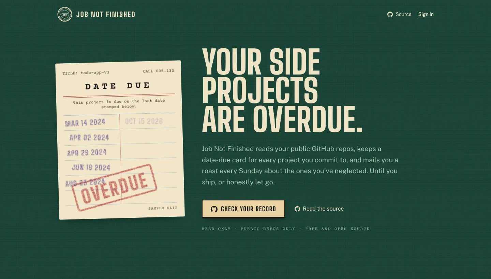
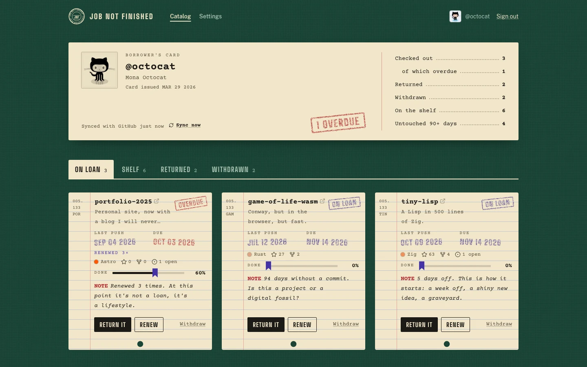

<p align="center">
  
</p>

<h1 align="center">Job Not Finished</h1>

<p align="center">
  <strong>Your side projects are overdue.</strong><br>
  Accountability for unfinished GitHub projects, delivered as a weekly roast built from your real commit history.
</p>

<p align="center">
  <a href="https://job-not-finished.vercel.app">Use it free</a> ·
  <a href="#self-hosting">Self-host it</a> ·
  <a href="CONTRIBUTING.md">Contribute</a>
</p>

---

Every developer has a graveyard of half-built repos. Job Not Finished treats each one like a library book you checked out and never returned. It reads your public GitHub repositories, keeps a date-due card for every project you commit to, and mails you an overdue notice every Sunday about the ones you've neglected, until you ship them or honestly let them go.

No boards, no tickets, no streaks. One card per project, and five stamps.

| Stamp | What it means |
| --- | --- |
| **Checked out** | You committed to finishing it. It gets a due date, 30 days out by default. |
| **Overdue** | You missed your own date. Sunday's notice will mention it, with your real push history. |
| **Renewed** | You asked for two more weeks. Every renewal is counted, and mentioned. |
| **Returned** | You shipped it. Job finished. |
| **Withdrawn** | You let it go on purpose, with an epitaph. Honest endings count too. |

<p align="center">
  
</p>

## Features

- **Your real record.** Sign in with GitHub and see every public repo you own: how many are unfinished, and how many haven't been touched in 90 days.
- **Catalog cards.** Each project shows its last push, stars, open issues, your progress, and its due date. Check out, renew, return, or withdraw it from the card.
- **Roasts from facts.** Every card carries a note rewritten weekly from what GitHub says. It stings the project, never you, and gets meaner the longer a project sits.
- **The Sunday notice.** One email a week about the projects you checked out, overdue first. One-click unsubscribe.
- **A public record, if you want one.** Share `/u/<your-login>` with a generated preview card. Off by default.
- **Leave any time.** Closing your card deletes everything and removes the app from your GitHub authorizations.

## Permissions and privacy

Sign-in asks GitHub for `read:user` and `user:email`, the narrowest scopes it offers. Job Not Finished can read your public repositories and profile. It cannot see private repositories and cannot write anything to GitHub. The access token is encrypted at rest, and every auth endpoint except the OAuth callback is disabled over HTTP, so the token never reaches a browser.

There are no analytics, ads, or tracking cookies. The [privacy page](https://job-not-finished.vercel.app/privacy) lists exactly what is stored.

## Self-hosting

You need Node 20.19+ (or Bun 1.2+), Postgres 14+, and a GitHub account. Email is optional: without it, notices are printed to the server log.

### 1. Install

```bash
git clone https://github.com/0xuser64bit/job-not-finished.git
cd job-not-finished
bun install
cp .env.example .env
```

### 2. Create a GitHub OAuth app

Go to **GitHub → Settings → Developer settings → OAuth Apps → New OAuth App**:

- **Homepage URL:** your `APP_URL`, for example `http://localhost:3000`
- **Authorization callback URL:** `APP_URL/api/auth/callback/github`

Copy the client ID and generate a client secret into `.env`.

### 3. Configure

| Variable | Required | Notes |
| --- | --- | --- |
| `DATABASE_URL` | yes | Postgres connection string. Use the pooled URL if your provider has one. |
| `DIRECT_URL` | no | Direct (non-pooled) URL for migrations. Falls back to `DATABASE_URL`. |
| `BETTER_AUTH_SECRET` | yes | 32+ random characters: `openssl rand -base64 32`. Also signs unsubscribe links, so rotating it invalidates old ones. |
| `APP_URL` | yes, except on Vercel | Public origin of the deployment. On Vercel it defaults to the production domain. |
| `GITHUB_CLIENT_ID` / `GITHUB_CLIENT_SECRET` | yes | From the OAuth app above. |
| `RESEND_API_KEY` | no | Sends real email through [Resend](https://resend.com). |
| `EMAIL_FROM` | with Resend | A sender on a domain verified in Resend, e.g. `Job Not Finished <notices@example.com>`. |
| `CRON_SECRET` | for notices | 16+ random characters. The digest endpoint requires it as a Bearer token. |

### 4. Migrate and run

```bash
bun run db:deploy
bun run dev
```

Open http://localhost:3000 and sign in.

### Deploying to Vercel

Import the repository, set the variables above, and deploy. The `vercel-build` script applies migrations before building, and `vercel.json` schedules the weekly notice for Sundays at 00:00 UTC. Vercel sends `CRON_SECRET` with each cron call automatically.

### Running the weekly notice elsewhere

Call the endpoint once a week from any scheduler:

```bash
curl -fsS -H "Authorization: Bearer $CRON_SECRET" https://your-domain.com/api/cron/digest
```

It is safe to call repeatedly: each user gets at most one notice every six days. If a run hits its time budget, the response says `"done": false` and the next call picks up where it stopped.

### Upgrading from v1

The v2 migration renames the v1 `User` and `Project` tables to `legacy_users` and `legacy_projects` instead of dropping them. When a v1 user signs in again, their progress and reminders move onto their synced projects (reminders become checked-out loans) and their legacy rows are deleted. Once `legacy_users` is empty, the legacy models can be dropped.

## Development

```bash
bun run dev         # Next.js dev server
bun run check       # lint, typecheck, unit tests
bun run build       # production build
bun run db:migrate  # create a migration after editing prisma/schema.prisma
bun run db:studio   # browse the database
```

The interesting parts live in `lib/`:

- `lifecycle.ts`: the one state machine every project change goes through
- `roast.ts`: the roast engine, deterministic per project per week
- `sync.ts` and `github.ts`: mirroring public repos with the user's own token
- `digest.ts` and `email/`: the weekly notice and its cron runner

## Built with

[Next.js 16](https://nextjs.org) · [React 19](https://react.dev) · [Better Auth](https://better-auth.com) · [Prisma 7](https://prisma.io) · [Tailwind CSS 4](https://tailwindcss.com) · [Resend](https://resend.com) · Postgres

## Contributing

Bug reports, roast lines, and pull requests are welcome. Start with [CONTRIBUTING.md](CONTRIBUTING.md). Report security issues privately, as described in [SECURITY.md](SECURITY.md).

## License

[MIT](LICENSE). Run your own desk.
